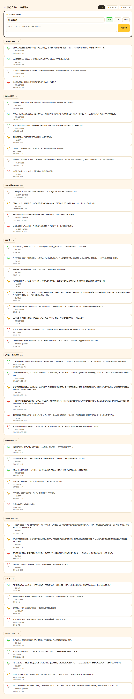
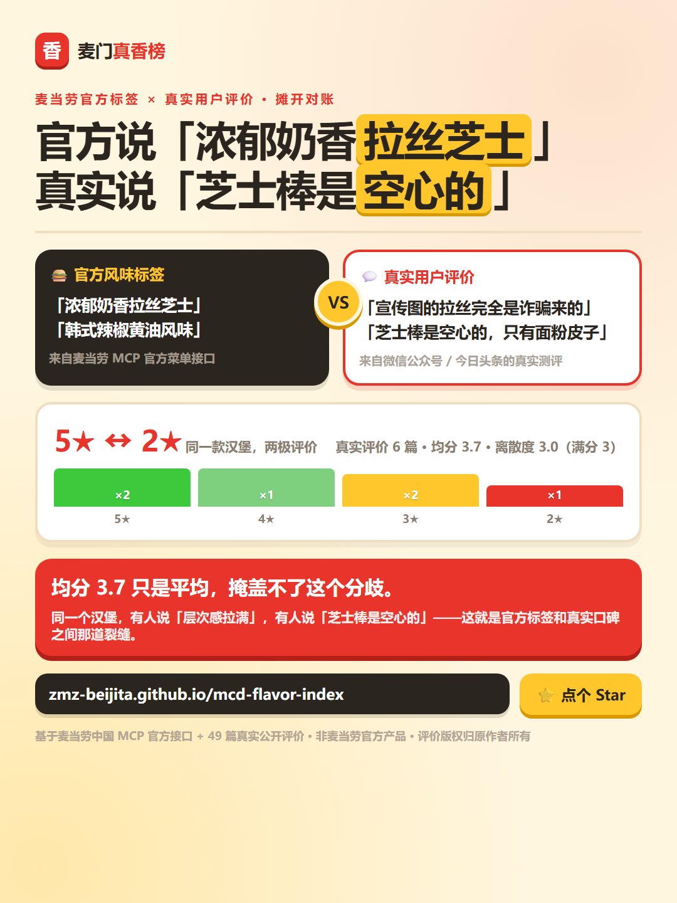

# 麦门真香榜 · McDonald's Flavor Index

<p align="center">
  
</p>

> ## 官方说「浓郁奶香拉丝芝士」
> ## 真实评价说「宣传图的拉丝完全是诈骗来的」
>
> **同一个汉堡，5 星和 2 星同时存在。** 麦当劳菜单接口和真实用户口碑之间那道裂缝，
> 就是这个项目要量出来的东西。

### 🎮 在线试玩（免 Token，打开即玩）

**<https://zmz-beijita.github.io/mcd-flavor-index/>**

点商品卡展开：官方风味标签 ↔ 真实共识对照、官方配料清单、评分离散度条、评价原文，
**还有一个能投票写理由的评论区**。

[](https://github.com/zmz-beijita/mcd-flavor-index)
[](https://mcp.mcd.cn)
[](#-免-token-打开即玩)
[](#-免-token-打开即玩)

**49 篇真实评价 · 9 款有口碑商品 · 115 个当前在售 · 官方标签落差逐条对账**


麦当劳程序员创意开发大赛参赛作品 · 非麦当劳官方产品

---

## 🎬 30 秒看懂


**打开就能玩，什么都不用装、不用填 Token。** 点商品卡展开：官方风味标签 ↔ 真实共识对照、
官方配料清单、评分离散度条、评价原文，**还有一个能投票写理由的评论区**。

## 🏆 真香榜（按真实评价均分排序）

| 排名 | 商品 | 真香指数 | 评分区间 | 样本 | 官方核价 | 官方风味标签 |
|:--:|---|:--:|:--:|:--:|:--:|---|
| 1 | 双层吉士汉堡 | **4.4** | 3.0–5.0 | n=5 | ¥23.00 | 100%纯牛肉 / 人气 |
| 2 | 板烧鸡腿堡 | **4.3** | 3.0–5.0 | n=7 | ¥23.50 | 板烧滋滋 / 多汁惹味 |
| 3 | 麦辣鸡腿堡 | **4.3** | 3.0–5.0 | n=6 | ¥22.50 | 人气 / 人气经典 |
| 4 | 安格斯厚牛堡 | **4.2** | 3.0–5.0 | n=4 | ¥31.50 | 100%纯牛肉 / 安格斯MAX |
| 5 | 巨无霸 | **4.0** | 3.0–5.0 | n=9 | ¥25.50 | 100%纯牛肉 / 人气 |
| 6 | 麦香鱼 | **4.0** | 3.0–5.0 | n=4 | ¥25.50 | 100%纯牛肉 / 麦香鱼 |
| 7 | 龙焰芝士棒鸡腿堡 | **3.7** | 2.0–5.0 | n=6 | ¥29.90 | 浓郁奶香拉丝芝士 / 韩式辣椒黄油风味 |
| 8 | 麦香鸡汉堡 | **3.5** | 3.0–4.0 | n=4 | ¥17.00 | 人气 / 单炸鸡类 |
| 9 | 不素之霸双层牛堡 | **3.2** | 2.0–4.0 | n=4 | ¥26.50 | 100%纯牛肉 / 人气 |

**为什么龙焰芝士棒排倒数第一？** 它的官方标签写着「浓郁奶香拉丝芝士」「趁热拉丝」，
但 6 篇真实评价里有人说「层次感拉满」，有人说「芝士棒是空心的，只有面粉皮子」——
**评分离散度 3.0（满分 3），全榜分歧最大。** 均分 3.7 只是平均，掩盖不了这个分歧。


## ✍️ 麦门广场：你能投票，也能写理由



**两个地方都能评论**——展开商品卡可以投票写理由，广场页顶部也有一张发帖框，
选商品 → 投票 → 写理由 → 发出，立刻按商品分组出现在广场里。

**理由才是可传播的内容。** 麦门已有的梗就是这么来的：

> 「宣传图的拉丝完全是诈骗来的」
> 「两根没有奶酪的芝士棒在麦当劳值三块钱」
> 「芝士棒是空心的，只有面粉皮子」

广场里的 49 条种子评价全部来自公开平台（小红书 / 什么值得买 / 大众点评 / 微信公众号 /
今日头条 / 现食研 / 新厨房 / 携程点评 / 新浪看点 / 搜狐美食），每条都标注来源，
差评也必须给出——不筛掉负面评价。

## 📣 转发素材

想推荐这个项目？这两张图和现成文案可以直接用：



- **[`docs/social-card.png`](docs/social-card.png)** —— 社媒长图（1080×1440，朋友圈 / 小红书 / 微博通用）
- **[`docs/SOCIAL_POSTS.md`](docs/SOCIAL_POSTS.md)** —— 各平台现成文案（朋友圈 / 小红书 / 技术社区 / 私聊）+ 发布时间建议
- **[`docs/TECH_ARTICLE.md`](docs/TECH_ARTICLE.md)** —— 技术社区长文（掘金 / 知乎 / 博客）

投票与投稿存在浏览器本地，不上传。

## 💡 为什么不是"又一个点餐助手"

| | 点餐助手 | 麦门真香榜 |
|---|---|---|
| 回答的问题 | 怎么点最省 | **官方说的和实际差多少** |
| 数据来源 | 菜单 + 券 | 菜单**官方标签** + **真实评价原文** |
| 是否需要消费记录 | 需要 | 不需要 |
| 产物 | 一个订单 | **可核查的口碑审计 + 可下单的方案** |
| 互动 | 无 | 投票 + 写理由 + 广场 |

**同赛道已有** `mcd-flavor-scout`（7 星，手工标 119 款口味）与 `mcd-mood-palette`（162 星，心情 × 营养打分）。
两者的口味数据都是**手工标注**的，不可溯源、不会更新。
本项目的官方标签**直接来自 MCP 接口、每日自动更新**，
并且多做一件没人做的事——**「官方 vs 真实」这道对账**。

> 榜单按 GitHub Star 排。前 100 名能拿实体徽章 + 3,000 WorkBuddy 积分。
> 如果这个对账的角度对你有用，**点个 Star** 就是最直接的投票。

## 📋 人气榜（当前时段在售全量）

**115 个商品**，覆盖门店当前在售的每一项，按品类与官方销量信号排序。
有真实评价的显示真香分，没有的标「待评价」——你投完，它就成了真香分。

> 麦当劳菜单**每日轮换**（凌晨切早餐、上午切正餐），所以人气榜是「现在能点什么」，
> 真香榜是「历史上大家怎么说」。两个时间维度，两个用途。

## 📱 微信小程序版

同款数据的小程序实现，三个 Tab：**真香榜 / 麦门广场 / 我的**。
纯原生微信小程序，零 npm 依赖、零云服务，投票与投稿只存本机。源码见 [`miniprogram/`](miniprogram/)。

## 🔌 用了哪些 MCP 工具

| 工具 | 用途 |
|---|---|
| `query-meals` | **官方风味标签**（`tags` 字段，麦当劳自己写的）与在售分类 |
| `query-meal-detail` | **官方配料清单**（`modification`）与**官方套餐结构**（`rounds`，每一档能换什么） |
| `calculate-price` | **唯一可信的价格来源**（单位：分） |
| `query-nearby-stores` | 按位置搜门店（`searchType` 必须是 2） |
| `campaign-calendar` | 官方活动文案（新品描述、联名、优惠预告） |
| `list-nutrition-foods` | 160 条营养数据（副维度：钠 / 蛋白 / 热量） |
| `now-time-info` | 确认当前时间 |

详见 [`MCP_INTEGRATION.md`](skills/mcd-flavor-index/MCP_INTEGRATION.md)，含 **8 条实测踩坑记录**。

## 📐 方法与边界

- **真香指数** = 该商品全部真实评价评分的算术平均（5 分制；各平台原生评分按公开规则归一到整数档位，映射表见 [`references/ugc-collection.md`](skills/mcd-flavor-index/references/ugc-collection.md)）
- **评分离散度** = 最高星 − 最低星，越大说明口碑越分裂
- **官方标签落差** = 官方标签声称的效果，是否被真实评价否定（关键词规则公开在 `build_home_data.py`，不做黑箱）
- 样本量与评分区间随商品一并公开，**样本少则可信度低**
- 评价原文版权归原作者所有，此处仅作短引用与统计

## 🔄 数据怎么保持新鲜

麦当劳菜单**每日轮换**（凌晨切早餐、上午切正餐），所以「人气榜」天然会过期。
这个项目的做法是**把刷新做成一键命令，并挂上定时任务**：

```bash
python scripts/refresh_all.py --push
```

一条命令跑完整条链路：

| 步骤 | 脚本 | 做什么 |
|---|---|---|
| 1 | `collect_menu.py` | 实时拉菜单（标签 / 配料 / 套餐结构 / 官方核价），**绝不硬编码 productCode** |
| 2 | `build_home_data.py` | 重建真香榜 + 人气榜 |
| 3 | `build_img_map.py` | 推导商品→图片映射，**自动补下载新上架商品的官方图** |
| 4 | `flavor_index.py --render` | 渲染单文件 `index.html` |
| 5 | `sync_miniprogram.py` | 同步微信小程序数据与资源 |
| 6 | `build_social_preview.py` / `build_social_card.py` | 重生成社交预览图与引流长图（数字自动注入） |
| 7 | `check_numbers.py --fix` | **15 项一致性自检**，并自动同步 README 里的数字 |
| 8 | `push_via_api.py` | 推送到 GitHub，Pages 1-3 分钟后自动生效 |

### 数据分两层，刷新策略不同

| 层 | 内容 | 更新方式 |
|---|---|---|
| **官方侧** | 菜单 / 风味标签 / 核价 / 配料 / 套餐结构 / 商品图 | ✅ **全自动**，每日定时刷新 |
| **口碑侧** | 49 篇真实公开评价（含来源与评分） | ⚠️ 需用 WebSearch 采集后写入 `data_ugc.json`，脚本**不会覆盖** |

口碑侧刻意不自动化：每条评价的原文、来源标注、评分档位都要人工核过，
`references/ugc-collection.md` 记录了完整采集口径。自动刷新只动官方侧，
避免把精心采集的来源标注冲掉。

### 为什么要有 `check_numbers.py`

数据散在 5 个地方：`data_ugc.json` → `data/home.json` → `index.html` 内联数据 →
小程序 `flavor.json` → README 文案。**任何一处不同步，评审一眼就能看出来。**

开发中真实踩过两个坑：

1. 社交预览图脚本把「评分离散度 ≥3 的商品数」（1 个）当成了「官方标签落差」（3 个）——
   两个同名不同义的指标混用，页面和预览图数字对不上，肉眼极难发现。
2. 菜单轮换后新上架 5 个商品，本地没有官方图，直接刷新会出现缺图。

所以 `check_numbers.py` 把这类检查固化成 **15 项断言**，其中包括
**校验页面模板的 DENY 规则与预览图脚本的 DENY 规则语义一致**——
规则公开不等于口径唯一，凡是页面上算的数，脚本必须用同一套判定规则。

## 📁 目录结构

```
mcd-flavor-index/
├── index.html                    # 交互式真香榜（单文件，免 Token）
├── data_ugc.json                 # 49 篇真实评价原始数据（含来源与评分）
├── data/home.json                # 首页双榜数据（真香榜 9 + 人气榜 115）
├── data/menu_full.json           # 115 个在售商品的官方标签 / 配料 / 套餐结构 / 图片地址
├── data/img_map.json            # 商品名 → 本地图片路径映射
├── assets/mcd-brand/             # 官方商品图（来自 MCP 返回的 CDN 地址）
├── docs/                         # 截图与社交预览图
├── scripts/
│   ├── collect_menu.py            # 采集门店菜单全量官方信息
│   ├── build_home_data.py         # 生成首页双榜数据
│   ├── build_img_map.py           # 从菜单数据推导「商品名 → 本地图片」映射
│   ├── sync_miniprogram.py        # 同步数据到微信小程序
│   ├── build_social_preview.py    # 生成 GitHub 社交预览图（数字自动注入）
│   ├── build_social_card.py       # 生成社媒引流长图 1080×1440
│   └── check_numbers.py           # 数字一致性自检（13 项，防止各处数字漂移）
├── miniprogram/                  # 微信小程序版（原生，零依赖）
└── skills/mcd-flavor-index/
    ├── SKILL.md                  # Skill 主流程与铁律
    ├── MCP_INTEGRATION.md        # MCP 调用说明 + 8 条踩坑
    ├── CONTEST_DECLARATION.md    # 参赛声明（官方文件，未改动）
    ├── mcp-config.example.json   # 脱敏 MCP 配置
    ├── workbuddy.md              # WorkBuddy 开发上下文
    ├── scripts/
    │   ├── flavor_index.py       # 真香指数计算 + 页面生成
    │   ├── mcd_client.py         # MCP 客户端（含空数据防护）
    │   ├── nutrition_index.py    # 营养库解析与名称对齐
    │   └── menu_solver.py        # 菜单抓取 + 组合枚举
    └── references/
        └── ugc-collection.md     # 评价采集方法与口径
```

## 🚀 免 Token 打开即玩

```bash
git clone https://github.com/zmz-beijita/mcd-flavor-index.git
cd mcd-flavor-index
open index.html          # macOS
# Windows：直接双击 index.html
```

零依赖、零构建、单文件。**商品图已全部下载到 `assets/mcd-brand/`（116 张官方图），离线可用**；
远程 CDN 地址作为兜底，图挂了会自动切换。图片映射由 `scripts/build_img_map.py` 从菜单数据自动推导，
菜单每日轮换后重跑一次即可，不会失配。

### 作为 WorkBuddy Skill 使用

```bash
cp -r skills/mcd-flavor-index ~/.workbuddy/skills/
```

在 WorkBuddy 左侧【专家·技能·连接器】→【自定义连接器】→【配置MCP】填入：

```json
{
  "mcpServers": {
    "mcd-mcp": {
      "type": "streamablehttp",
      "url": "https://mcp.mcd.cn",
      "headers": { "Authorization": "Bearer YOUR_MCP_TOKEN" }
    }
  }
}
```

保存并启用后，在对话里说「**麦当劳现在什么最值得吃**」即可。

```bash
export MCD_MCP_TOKEN=你的token

# 采集门店菜单全量官方信息（标签 / 配料 / 套餐结构 / 核价）
python scripts/collect_menu.py --store 1450713

# 重新生成首页数据、图片映射与页面
python scripts/build_home_data.py
python scripts/build_img_map.py
python skills/mcd-flavor-index/scripts/flavor_index.py --render

# 同步到微信小程序（数据 / 图片映射 / 资源文件）
python scripts/sync_miniprogram.py

# 重新生成社交预览图与引流长图
python scripts/build_social_preview.py
python scripts/build_social_card.py

# 数字一致性自检（13 项：落差规则 / 篇数 / 在售数 / 内联数据 / README 数字）
python scripts/check_numbers.py
```

> 全部脚本零第三方依赖，只用 Python 标准库。

### 为什么要有 `check_numbers.py`

这个项目的数据散在 5 个地方：`data_ugc.json` → `data/home.json` → `index.html` 内联数据 →
微信小程序 `flavor.json` → README 文案。**任何一处数字不同步，评审一眼就能看出来。**

开发中真实踩过：社交预览图脚本把「评分离散度 ≥3 的商品数」（1 个）
当成了「官方标签落差」（3 个）——两个同名不同义的指标混用，
预览图和页面显示的数字对不上，肉眼极难发现。

`check_numbers.py` 把这类检查固化成 13 项断言，**包括校验页面模板的 DENY 规则
与预览图脚本的 DENY 规则语义一致**，任何一处漂移都会被立刻抓出来。

## 📄 许可证

MIT
