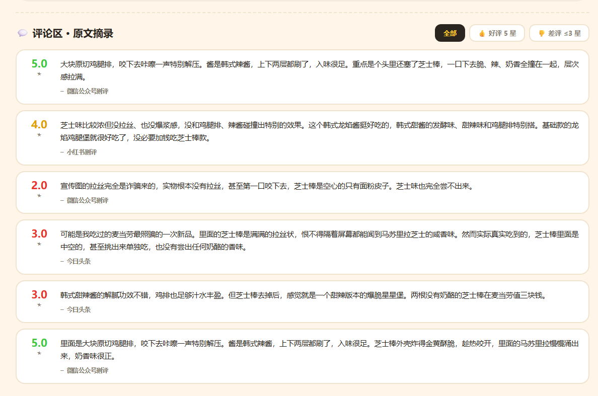
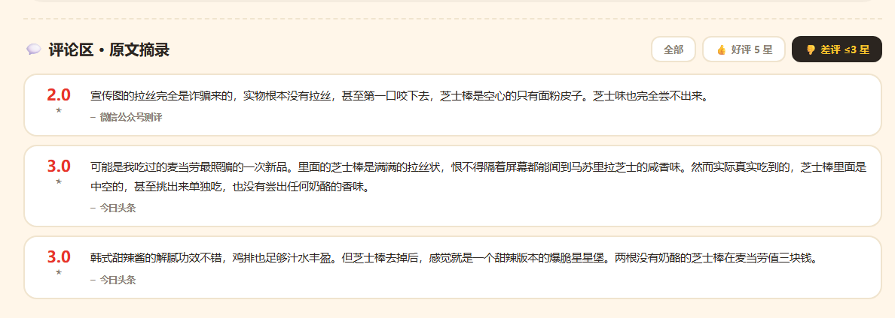

# 麦门真香榜 · McDonald's Flavor Index

> **官方说「浓郁奶香拉丝芝士」，真实评价说「宣传图的拉丝完全是诈骗来的」。**
>
> 麦当劳菜单接口和真实用户口碑之间那道裂缝，就是这个项目要量出来的东西。

[](https://github.com/zmz-beijita/mcd-flavor-index)
[](https://mcp.mcd.cn)
[](#安装)
[](#-免-token-打开即玩)

麦当劳程序员创意开发大赛参赛作品 · 非麦当劳官方产品

---

## 这是什么

一个**把官方宣传和真实口碑摆在一起对账**的麦当劳口味索引。

市面上的麦当劳工具几乎都在回答同一个问题：「这一单怎么点最省」。
本项目换个方向——**点餐决策的真正起点不是价格，是「我今天想吃什么味」，而官方推荐的东西不一定真好吃。**

具体做法：

1. 从麦当劳 MCP `query-meals` 拿**官方风味标签**（44 种，是麦当劳自己写在菜单接口里的）
2. 从公开用户评价（小红书 / 什么值得买 / 大众点评 / 微信公众号 / 今日头条 / 现食研）拿**真实口碑**
3. 算出**真香指数**（真实评价评分的算术平均）、**评分离散度**、**官方标签落差**
4. 把两边逐条摊开——**差评原文必须给出来，均分不算数**

## 📱 微信小程序版

同款数据的小程序实现，三个 Tab：**真香榜 / 麦门广场 / 我的**。

「麦门广场」借鉴了爆款小程序「钱包请等等」的核心机制——**投票 + 理由**：
光点赞不够，要让人写一句理由，理由才是可传播的内容。

问法不是「该不该买」（用户没这动机），而是：

> **「这顿你觉得值不值？」** → 真香 / 一般 / 踩雷 + 一句理由（≤60 字）→ 发到麦门广场

纯原生微信小程序，零 npm 依赖、零云服务，投票与投稿只存本机。
源码见 [`miniprogram/`](miniprogram/)。

## 💡 一句话看懂

麦当劳菜单接口给「龙焰芝士棒鸡腿堡」打的标签是：

```
浓郁奶香拉丝芝士 · 趁热拉丝 · 奶香醇厚
```

而这个商品 6 篇真实评价的分布是：

| 评分 | 原文摘录 | 来源 |
|:--:|---|---|
| 5.0 ★ | 大块原切鸡腿排，咬下去**咔嚓**一声特别解压……脆、辣、奶香全撞在一起，**层次感拉满** | 微信公众号测评 |
| 5.0 ★ | 芝士棒外壳炸得金黄酥脆，趁热咬开，里面的马苏里拉慢慢涌出来，**奶香味很正** | 微信公众号测评 |
| 4.0 ★ | 芝士味比较浓但**没拉丝**、也没爆浆感……基础款的龙焰鸡腿堡就很好吃了，没必要加钱吃芝士棒款 | 小红书测评 |
| 3.0 ★ | 里面的芝士棒是满满的拉丝状……然而实际真实吃到的，芝士棒里面是**中空**的 | 今日头条 |
| 3.0 ★ | 韩式甜辣酱的解腻功效不错……但芝士棒去掉后，感觉就是一个甜辣版本的爆脆星星堡。**两根没有奶酪的芝士棒在麦当劳值三块钱** | 今日头条 |
| 2.0 ★ | 宣传图的拉丝完全是**诈骗**来的，实物根本没有拉丝，甚至第一口咬下去，芝士棒是**空心**的只有面粉皮子 | 微信公众号测评 |

**真香指数 3.7 / 5，评分区间 2.0–5.0，离散度 3.0（满分 3）——全榜分歧最大的商品。**

同一份「浓郁奶香拉丝芝士」的官方标签，撑起了 5 星和 2 星两种截然不同的体验。

### 顺带挖出来的一件事：汉堡到底缩水没有

评价里反复出现"缩水"。查证后是真的：

> 「双层吉士堡的直径从历史巅峰的 13 厘米，一路缩水至如今的 8-8.5 厘米……仅比一张银行卡略宽」
> 「巨无霸肉饼单片重量从 25 克缩减至 22 克左右，整体体积仅约 477 立方厘米」
> —— 中华网实测报道（已收录进数据集，评分 3.0 ★）

有意思的是，**官方标签对这件事只字未提**——菜单接口给双层吉士的标签是「100%纯牛肉 / 人气」，
既没说缩水，也没说没缩水。本项目把这条差评原样放进榜单，不替麦当劳圆场，也不跟着起哄。

## 📊 当前真香榜

样本 34 篇 / 6 个在售商品 · 采集于 2026-10-25 · 价格经 `calculate-price` 官方核价

| 排名 | 商品 | 真香指数 | 评分区间 | 样本 | 官方核价 | 官方风味标签 |
|:--:|---|:--:|:--:|:--:|:--:|---|
| 1 | 双层吉士汉堡 | **4.4** | 3.0–5.0 | n=5 | ¥23.00 | 100%纯牛肉 / 人气 |
| 2 | 麦辣鸡腿堡 | **4.2** | 3.0–5.0 | n=5 | ¥22.50 | 人气 / 人气经典 |
| 3 | 板烧鸡腿堡 | **4.2** | 3.0–5.0 | n=6 | ¥23.50 | 板烧滋滋 / 多汁惹味 / 新升级 |
| 4 | 巨无霸 | **4.0** | 3.0–5.0 | n=8 | ¥25.50 | 100%纯牛肉 / 人气 / 爆款 |
| 5 | 龙焰芝士棒鸡腿堡 | **3.7** | 2.0–5.0 | n=6 | ¥29.90 | 浓郁奶香拉丝芝士 / 韩式辣椒黄油风味 / 上新 |
| 6 | 麦香鸡汉堡 | **3.5** | 3.0–4.0 | n=4 | ¥17.00 | 人气 |

> 样本量与评分区间必须一起看：n=2 的商品可信度低于 n=5 的商品，页面上都标了。

## 🎨 交互式真香榜

`index.html` 是一个**能点的**单文件页面（无需 Token，双击即开）：

- **点商品卡** → 切换到该商品的详情：真香分 / 评分离散度条 / 官方标签 vs 真实共识对账
- **点评论区筛选** → 全部 / 👍 好评 5 星 / 👎 差评 ≤3 星
- **点顶部按钮** → 跳到最值得吃的、看评论区、看数据来源


### 官方标签 vs 真实口碑（点任意商品卡切换）


### 评论区（可按好评/差评筛选，冲突词高亮）



点「👎 差评 ≤3 星」只看被吐槽的：



## 🚀 免 Token 打开即玩

```bash
git clone https://github.com/zmz-beijita/mcd-flavor-index.git
cd mcd-flavor-index
open index.html          # macOS
# Windows：直接双击 index.html
```

零依赖、零构建、单文件，图片已 base64/相对路径内嵌。

## 🔧 作为 WorkBuddy Skill 使用

```bash
git clone https://github.com/zmz-beijita/mcd-flavor-index.git
cp -r mcd-flavor-index/skills/mcd-flavor-index ~/.workbuddy/skills/
```

### 前置条件

1. 申请麦当劳 MCP Token → <https://mcp.mcd.cn>（手机号登录 → 控制台 → 激活）
2. 在 WorkBuddy 左侧【专家·技能·连接器】→【自定义连接器】→【配置MCP】，填入：

```json
{
  "mcpServers": {
    "mcd-mcp": {
      "type": "streamablehttp",
      "url": "https://mcp.mcd.cn",
      "headers": {
        "Authorization": "Bearer YOUR_MCP_TOKEN"
      }
    }
  }
}
```

> ⚠️ 记得把 `YOUR_MCP_TOKEN` 换成你的实际 Token，然后【保存】并【启用】。

### 命令行

```bash
export MCD_MCP_TOKEN=你的token

# 离线真香榜
python skills/mcd-flavor-index/scripts/flavor_index.py --list

# 单品深挖（含差评原文与落差检测）
python skills/mcd-flavor-index/scripts/flavor_index.py --item 龙焰芝士棒

# 拉取当前门店的官方标签与核价
python skills/mcd-flavor-index/scripts/flavor_index.py --sync --city 上海 --keyword 人民广场

# 生成交互式页面
python skills/mcd-flavor-index/scripts/flavor_index.py --render --out flavor-index.html
```

在 WorkBuddy 里直接说「**麦当劳现在什么最值得吃**」「**龙焰芝士棒真的好吃吗**」即可。

## 🔌 用了哪些 MCP 工具

| 工具 | 用途 |
|---|---|
| `query-meals` | 拿在售商品与**官方风味标签**（`tags` 字段，44 种） |
| `query-meal-detail` | 拿套餐结构、子项差价、官方商品图地址 |
| `calculate-price` | **唯一可信的价格来源**，单位是分 |
| `query-nearby-stores` | 按位置搜门店（`searchType=2` 才是按位置搜） |
| `list-nutrition-foods` | 158 条营养数据（副维度：钠/蛋白/热量） |
| `now-time-info` | 确认当前时间 |

详见 [`MCP_INTEGRATION.md`](MCP_INTEGRATION.md)，含 8 条实测踩坑记录。

## 💡 为什么不是"又一个点餐助手"

| | 点餐助手 | 麦门真香榜 |
|---|---|---|
| 回答的问题 | 怎么点最省 | 官方说的和实际差多少 |
| 数据来源 | 菜单 + 券 | 菜单**官方标签** + **真实评价原文** |
| 是否需要消费记录 | 需要 | 不需要 |
| 产物 | 一个订单 | 一份可核查的口碑审计 + 可下单的方案 |
| 别人做过吗 | 133+ 个项目 | 口味方向已有 `mcd-flavor-scout`（7星，手工标 119 款）、`mcd-mood-palette`（154星）；<br>**「官方标签 vs 真实口碑」的对账维度无人做** |

**关键差异**：同赛道已有项目手工标注口味（不可溯源、会过时），本项目的官方标签**直接来自 MCP 接口、每日自动更新**，并且**多出"官方 vs 真实"这道对账**。

## 📐 方法与边界

- **真香指数** = 该商品全部真实评价评分的算术平均（5 分制，采用各平台原生评分，未二次折算）
- **评分离散度** = 该商品最高星 − 最低星
- **官方标签落差** = 官方标签声称的效果，是否被真实评价否定（关键词规则公开在 `flavor_index.py`）
- 评价原文版权归原作者所有，此处仅作短引用与统计
- **本项目为民间口碑整理，非麦当劳官方产品**，不构成对任何商品的评价或推荐

## 📁 目录结构

```
mcd-flavor-index/
├── index.html                    # 交互式真香榜（单文件，免 Token）
├── data_ugc.json                 # 34 篇真实评价原始数据（含来源与评分）
├── assets/mcd-brand/             # 官方商品图（来自 MCP 返回的 CDN 地址）
├── miniprogram/                  # 微信小程序版（原生，零依赖）
│   ├── app.js / app.json / app.wxss
│   ├── data/flavor.json          # 预置榜单数据
│   ├── assets/                   # 商品图 + tabBar 图标
│   ├── utils/flavor-store.js     # 数据层：读榜单 / 投票 / 投稿 / 广场流
│   └── pages/{index,detail,square,profile}/
├── docs/
│   ├── screenshot-hero.png       # 首页截图
│   ├── screenshot-detail.png     # 详情页截图
│   └── screenshots/              # README 图集
└── skills/mcd-flavor-index/
    ├── SKILL.md                  # Skill 主流程与铁律
    ├── MCP_INTEGRATION.md        # MCP 调用说明 + 8 条踩坑
    ├── CONTEST_DECLARATION.md    # 参赛声明（官方文件，未改动）
    ├── mcp-config.example.json   # 脱敏 MCP 配置
    ├── workbuddy.md              # WorkBuddy 开发上下文
    ├── scripts/
    │   ├── flavor_index.py       # 真香指数计算 + 页面生成
    │   ├── mcd_client.py         # MCP 客户端（含空数据防护）
    │   ├── nutrition_index.py    # 营养库解析与名称对齐
    │   └── menu_solver.py        # 菜单抓取 + 组合枚举
    └── references/
        └── ugc-collection.md     # 评价采集方法与口径
```

## 📄 许可证

MIT
